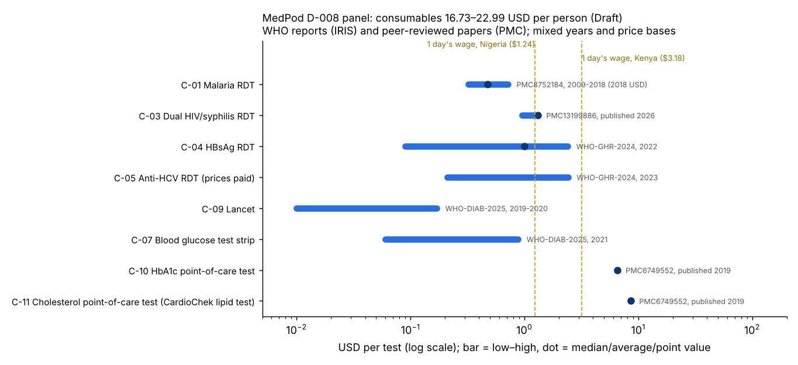

# Test Menu v0.1: Draft

**Status:** Draft. Built 2026-11-02 from official WHO sources. Owner approved D-007 (EDL 5) and D-008
(first cartridge set) on 2026-11-02. Costs for the D-008 set added the same day (see "Cost per person").
Accuracy is not filled in yet (see "Gaps").
**Data:** `data/test_menu.csv`, `data/test_costs.csv`, `data/README.md` (sources, licence).
**Checked by:** `tests/test_test_menu_data.py` (T-001…T-007), `tests/test_test_costs.py` (T-008…T-012).
**Pictures:** `docs/img/test_menu.png`, `docs/img/test_costs.png`

## What changed since the plan (important)
1. **WHO's current list is EDL 5, not EDL 4.** The electronic EDL now says "Fifth WHO model list of
   essential in vitro diagnostics (EDL 5)", © WHO 2025. EDL 5 replaces EDL 4's "Tier I / Tier II"
   with **Setting: Non-laboratory / Laboratory** plus a "tiered testing service" (community/outreach,
   primary health care centre without laboratory, district hospital, …). I fetched both:
   - EDL 4 Tier I: 39 rows from WHO TRS 1053 (`data/who_edl4_tier1.csv`).
   - EDL 5 (all 234 rows, 39 Non-laboratory): `data/who_edl5.csv`.
   The menu uses **EDL 5 Non-laboratory**, because it is the newer list. Approved by the owner as D-007.
2. **Moving from EDL 4 Tier I to EDL 5** (from the row-by-row cross-check):
   - Moved to Laboratory: ABO/Rh slide agglutination, ESR, HBeAg (specimen also changed to serum/plasma),
     HIV qualitative and quantitative NAT, influenza NAT, hCG latex agglutination.
   - Not found in EDL 5: urine bilirubin dipstick, influenza A/B antigen RDT, TB skin tests (TST/TBST).
   - New in EDL 5 Non-laboratory: microhaematocrit, G6PD (POC test and RDT), Kato-Katz, lead,
     total cholesterol, creatinine, HCV self-test, cholera dipstick.
3. **GHE 2021 DALYs could not be fetched.** www.who.int, cdn.who.int and the GHO API are blocked from
   the cloud (proxy 403; web-fetch "ENOTFOUND"). What I could get: the **2021 top-10 causes of death by
   World Bank income group** from *World health statistics 2024*, Fig. 1.9 (on iris.who.int), which uses
   GHE 2021. So the ranking below uses **deaths, not DALYs**. The order may change once DALYs are added.

## Burden: top 10 causes of death, 2021 (WHO GHE 2021 via WHS 2024 Fig. 1.9)
| Rank | Low-income | Lower-middle-income |
|---|---|---|
| 1 | Lower respiratory infections | COVID-19 |
| 2 | Stroke | Ischaemic heart disease |
| 3 | Ischaemic heart disease | Stroke |
| 4 | Malaria | Chronic obstructive pulmonary disease |
| 5 | Preterm birth complications | Lower respiratory infections |
| 6 | COVID-19 | Tuberculosis |
| 7 | Diarrhoeal diseases | Diarrhoeal diseases |
| 8 | Tuberculosis | Diabetes mellitus |
| 9 | Birth asphyxia and birth trauma | Cirrhosis of the liver |
| 10 | HIV/AIDS | Preterm birth complications |

## Pod methods
- **Pod sensor:** no consumable (BP, ECG, SpO2, temperature, weight, camera, microphone).
- **Cartridge reader:** a WHO-listed lateral-flow RDT or dipstick, read by the pod's camera under
  controlled light. Accuracy of camera reading is **unverified** and needs its own test per cartridge.
- **Handheld analyser:** EDL "point-of-care test" formats that need an instrument (glucose, HbA1c,
  Hb, cholesterol, creatinine, CD4, G6PD, lead). We would integrate an existing meter, not build one.
- **Refer:** test exists only in the Laboratory setting, or the EDL purpose says it must not be used
  for individual diagnosis.

## The menu
Priority **A** = top-10 cause of death in LIC or LMIC *and* an EDL 5 Non-laboratory test.
**B** = EDL 5 Non-laboratory test, burden rank pending (not in the top 10 deaths; DALYs not fetched).
**C** = top-10 cause with no IVD: pod sensor or referral. Draft until a WHO guideline is sourced.
EDL ids link to `https://edl.who-healthtechnologies.org/recommendations/<id>`.

| Pri | Condition | GHE 2021 rank (LIC / LMIC) | EDL 5 ids | Pod method | Notes |
|---|---|---|---|---|---|
| A | Malaria | 4 / – | 34, 114, 115 | cartridge reader | Plasmodium RDT. G6PD informs primaquine/tafenoquine (EDL purpose). Pod refers, never prescribes. |
| A | HIV infection | 10 / – | 24, 25, 26, 29, 30 | cartridge reader | Antibody RDTs. CD4 (29) needs an instrument; CrAg (30) is only for advanced HIV disease. |
| A | Tuberculosis | 8 / 6 | 32 | cartridge reader (limited) | Urine LAM only for people living with HIV (EDL purpose). All other EDL 5 TB tests are Laboratory: refer. Cough-sound AI is Draft research. |
| A | COVID-19 | 6 / 1 | 16 | cartridge reader | Antigen RDT, upper respiratory swab. |
| A | Diabetes mellitus | – / 8 | 4, 19, 17, 5 | handheld analyser | Capillary glucose, HbA1c; urine glucose only if blood glucose is unavailable; ketones. |
| A | Cardiovascular risk (IHD, stroke) | 3, 2 / 2, 3 | 227 | handheld analyser | Total cholesterol: "to assess risk of cardiovascular disease". |
| A | Chronic hepatitis B and C | cirrhosis – / 9 | 20, 22, 233 | cartridge reader | HBsAg RDT, anti-HCV RDT and self-test. **Draft:** the share of cirrhosis caused by HBV/HCV in LIC/LMIC is not sourced yet. |
| A | Diarrhoeal disease (cholera) | 7 / 7 | 14, 15 | refer | EDL: cholera RDTs "cannot be used to confirm individual cholera cases". Outbreak surveillance flag only. |
| C | Hypertension | (IHD, stroke) | – | pod sensor | BP isn't an IVD, so it isn't in the EDL. **Draft:** thresholds must come from the WHO hypertension guideline (fetch from IRIS). |
| C | Lower respiratory infections | 1 / 5 | – | pod sensor → refer | No EDL 5 non-lab IVD (CRP is Laboratory). SpO2, temperature, breathing rate. **Draft:** danger-sign thresholds need a WHO source. |
| C | COPD | – / 4 | – | refer | No IVD. Spirometry isn't in pod v0.1. Possible future module. |
| – | Preterm birth, birth asphyxia | 5, 9 / 10 | – | out of scope | Newborn conditions; the capsule is built for adults (D-006). |
| B | Anaemia | – | 8 (97) | handheld analyser | Hb POC (8). Microhaematocrit (97): equipment needs not yet checked. |
| B | Syphilis | – | 37, 38 | cartridge reader | Treponemal RDT; dual HIV/syphilis RDT. |
| B | Kidney disease, UTI | – | 3, 6, 228 | cartridge reader + analyser | Urine albumin and urinalysis dipsticks; creatinine POC. |
| B | Pregnancy | – | 10, 11 | cartridge reader | Urine beta-hCG. |
| B | Sickle cell disease | – | 36 | cartridge reader | Haemoglobin A/S/C RDT. |
| B | Hepatitis E | – | 23 | cartridge reader | anti-HEV IgM RDT. |
| B | Group A strep pharyngitis | – | 35 | cartridge reader | Throat swab: who takes it in an unattended pod is an open question. |
| B | Blood group ABO/Rh | – | 1 | cartridge reader | Reading an agglutination card by camera is unverified. |
| B | Lead exposure | – | 226 | handheld analyser | |
| B | Chagas, visceral leishmaniasis | – | 13, 39 | cartridge reader | Only where these diseases occur. |
| B | Soil-transmitted helminths, schistosomiasis | – | 174 | refer | Kato-Katz is stool microscopy, so the pod can't do it. |

## What this means for the pod (proposal, for discussion)
- One **cartridge reader** is the main method for 13 of the 23 rows. It is the single most useful piece of hardware
  after the vitals sensors. Most of those tests use **capillary whole blood**, so the finger-prick
  station in the plan is confirmed as needed.
- A small set of **handheld analysers** (glucose/HbA1c, Hb, cholesterol, creatinine) covers the
  noncommunicable-disease side. These are instrument tests in the EDL, not RDTs.
- **First cartridge set (D-008, owner approved):** malaria, HIV, HBsAg and anti-HCV rapid tests (all priority A,
  all capillary blood), plus syphilis (B, but it shares the dual HIV/syphilis test). For the NCD side:
  **glucose/HbA1c and cholesterol**, plus the BP cuff.

## Cost per person for the D-008 set (Draft)
**Where the prices come from.** The official price lists (Global Fund, UNICEF Supply Catalogue, CHAI, FIND) are blocked
from the cloud. So every price below comes from a WHO report on IRIS or a peer-reviewed paper on PMC, with
its exact quote stored in `data/test_costs.csv`.

| Item (EDL 5 id) | USD per test | Basis, year | Source |
|---|---|---|---|
| Malaria RDT (34) | 0.323–0.718, median 0.473 | Global Fund-financed purchases, 2009–2018, 2018 USD (IQR) | Malar J 2022;21:12 (PMC8752184), Table 2 |
| HIV antibody RDT (25) | "typically around $0.75–$0.80" | LMIC programmes | Health Policy Open 2026 (PMC13199886) |
| Dual HIV/syphilis RDT (38) | 0.95 ceiling for a WHO-prequalified test; 1.31 weighted average paid | LMIC programmes | same |
| HBsAg RDT (20) | about 1; range 0.09 (India) – 2.40 (Nigeria) | public sector, 2022 | WHO Global hepatitis report 2024, PDF p.72 |
| Anti-HCV RDT (22) | 0.21–2.42 paid; benchmark 0.80–1.10 ex works (Global Fund PPM) | public sector, 2023 | same, PDF p.75 |
| Glucose strip (4) | 0.06–0.88 (low-income countries); global average 0.29 | 2021; 2019 | WHO diabetes technologies report 2025, Table 4 |
| Lancet | 0.01–0.17 | 2019–2020 | same, Table 5 |
| HbA1c POC (19) | 6.52 | field study cost (Haiti), published 2019 | PMC6749552 |
| Cholesterol POC (227) | 8.57 (CardioChek lipid test) | same study | PMC6749552 |
| BP measurement | "negligible because equipment was reused" | same study | PMC6749552 |

**Per person:** consumables only (`python3 tools/test_costs.py`). The days'-wage figures use the lowest daily
wages in the WHO 2025 diabetes report, Table 11 (Kenya $3.18, Nigeria $1.24). The report says these were
"searched for on the internet and may not always be comparable".

| Panel (cumulative) | USD per person | Days' wages, Kenya | Days' wages, Nigeria |
|---|---|---|---|
| RDTs: malaria, dual HIV/syphilis, HBsAg, anti-HCV, + 1 lancet | 1.58–7.02 | 0.5–2.2 | 1.3–5.7 |
| + blood glucose strip | 1.64–7.90 | 0.5–2.5 | 1.3–6.4 |
| + HbA1c POC | 8.16–14.42 | 2.6–4.5 | 6.6–11.6 |
| + cholesterol POC | 16.73–22.99 | 5.3–7.2 | 13.5–18.5 |

**What this shows**
- **The four infection RDTs are cheap:** about $1.6–7 per person in total. The wide range comes from HBsAg and anti-HCV
  prices paid by different countries.
- **HbA1c and cholesterol make up 66–90% of the full panel cost.** Both figures come from a single field study, so they are
  the weakest numbers here. They are also the best place to cut cost. Options to evaluate:
  glucose strip first and HbA1c only if glucose is raised; cholesterol only for people at higher risk.
  The referral rules must come from WHO guidelines (HEARTS‑D, on IRIS), not from us.
- **What the per-person figure leaves out:** devices (glucose meter $11.83–29.32; cholesterol analyser $500, both sourced), staff,
  shipping, import duty, quality control, waste, and the pod itself. A real price per visit will be higher.
- **Caveat:** these figures mix years (2009–2026) and price types (procurement price, price paid, study cost).
  Treat them as order of magnitude only, until one official price list covers every item.

## Gaps (also in `docs/limitations.md`)
1. **GHE 2021 DALYs** by income group: blocked (www.who.int). Need the owner to allow `www.who.int`
   and `cdn.who.int`, or to download the GHE 2021 DALY spreadsheet on the PC and add it to `data/`.
2. **Cost per test:** a first pass is done for the D-008 set (above). It is still weak for HbA1c and cholesterol (one
   study) and has no BP device price. Official lists (Global Fund PPM reference prices, UNICEF Supply Catalogue,
   CHAI/FIND) need `www.theglobalfund.org`, `supply.unicef.org`, `www.clintonhealthaccess.org`, `www.finddx.org` allowed.
3. **Accuracy per test:** each e-EDL page has a "Summary of Evidence Evaluation". These aren't extracted yet.
4. **Camera reading of RDTs:** no evidence collected yet. Needs a literature search and our own bench test.
5. **Referral thresholds** (BP, SpO2, glucose, Hb): must come from the relevant WHO guidelines on IRIS.
6. EDL is a *model* list. Each country has its own national EDL and guidelines, so a deployment must
   follow its national list.
